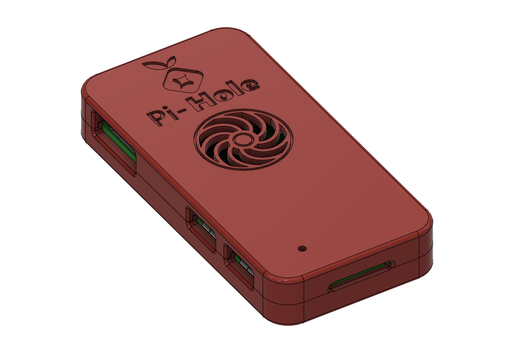
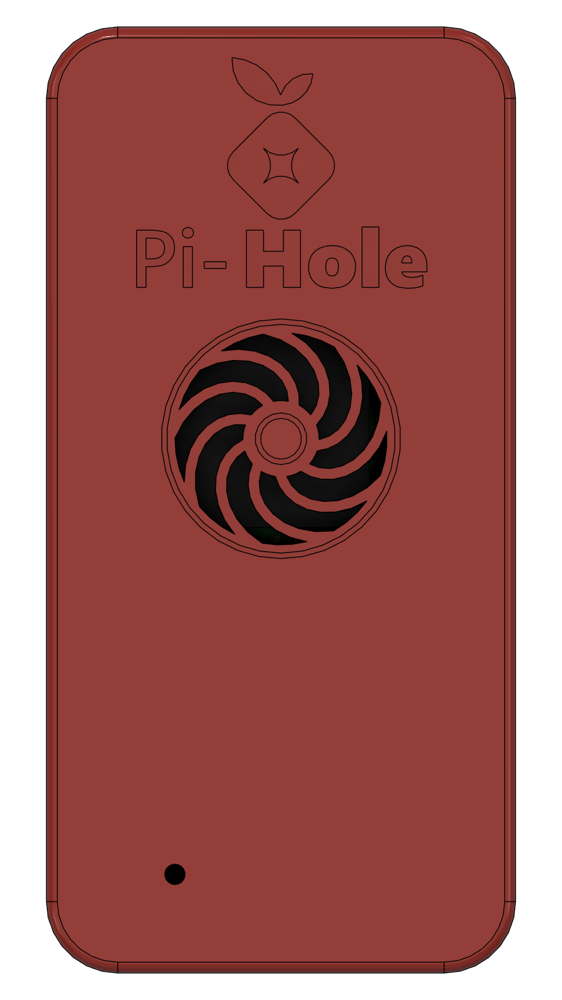
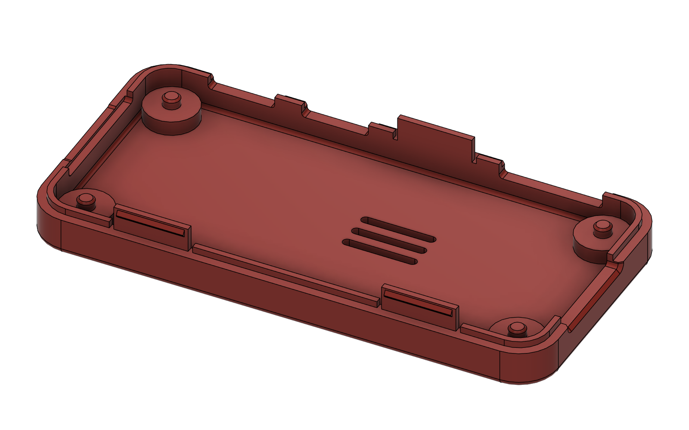
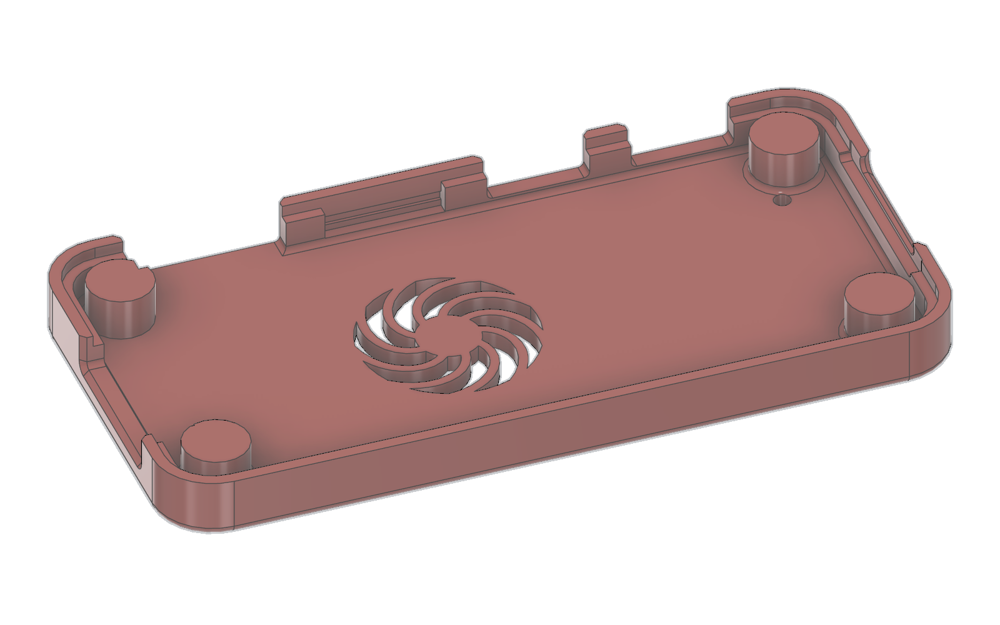

# Pi-hole Zero 2W Case

A compact two-piece resin (SLA) enclosure for a **Raspberry Pi Zero 2W** running [Pi-hole](https://pi-hole.net/). The lid snaps onto the base, so you don't need screws or nuts. The lid has a swept-blade, fan-style vent over the processor, and the Pi-hole logo and wordmark are engraved into the lid.

  

| Base: snap tabs and locating pins | Lid underside: tab pockets and catch grooves |
|---|---|
|  |  |

## Features

- **Fan-style vent** with 9 curved blade cutouts and a solid hub, centred over the RP3A0 processor so heat can escape through the lid.
- **Engraved Pi-hole logo and "Pi-Hole" wordmark**, 0.5 mm deep. You can fill the engraving with paint to add colour.
- **Cutouts for every port:** mini HDMI, USB OTG, USB power, microSD (with a fingernail notch) and the CSI camera ribbon.
- **ACT LED window** so you can see the activity light with the lid closed.
- **Snap-fit lid:** three flexible tabs on the base (two on the GPIO side, one between the mini HDMI and USB ports) click into grooves inside the lid wall. No screws or nuts are needed.
- **Locating pins:** a 2.3 mm pin on each standoff passes through the board's 2.7 mm mounting holes so the board can't slide around.
- **PCB clamp bosses** in the lid hold the board down onto the standoffs.
- **Alignment lip** that keys the lid onto the base.

## Files

| File | Part | Size (mm) | Volume |
|---|---|---|---|
| [`stl/PiHole_Lid.stl`](stl/PiHole_Lid.stl) | Lid | 69.5 × 34.5 × 5.45 | 4.7 cm³ |
| [`stl/PiHole_Base.stl`](stl/PiHole_Base.stl) | Base | 69.5 × 34.5 × 8.4 | 5.3 cm³ |

Both files are binary STLs in **millimetres**. The base is 8.4 mm tall measured to the tops of the snap tabs, which sit inside the lid once it's closed. The assembled case is still 10.55 mm tall.

## Printing

Designed and checked for Formlabs-style resin printers.

- **Resin:** a tough or durable resin (for example Formlabs Tough 2000 or Durable) is the best choice, because the snap tabs flex every time you open the case. Standard resin also works, but the tabs are more likely to crack after many openings. One full case uses about **10 mL** of part volume, or roughly **13–16 mL** including supports and raft.
- **Layer height:** 0.1 mm.
- **Orientation:** let PreForm **Auto-Orient** the parts. Don't print either part flat with its open side facing the build platform, because a hollow shell in that position creates suction forces that can make the print fail.
- **Supports:** keep them off the engraved top of the lid. Put them on the inside faces or the edges. Keep them off the outer faces of the snap tabs and out of the catch grooves inside the lid wall, because support marks there change how the snap feels.
- **Post-processing:** wash and cure the parts fully before fitting the board.

Smallest features, all at or above typical resin printer limits:

| Feature | Size |
|---|---|
| Thinnest engraved stroke ("Pi-") | 0.50 mm |
| Vent ring grooves | 0.40 mm |
| Vent spokes | 0.80 mm |
| Walls (side / lid / floor) | 2.0 / 1.5 / 1.5 mm |
| Snap tabs | 0.8 mm thick |
| Lid wall behind the catch grooves | 0.75 mm |

## Hardware

None. The lid snaps on.

## Assembly

1. Set the Pi Zero 2 W onto the standoffs with its mounting holes over the four locating pins and the ports lined up with the side cutouts.
2. Line the lid up with the base, with the fan vent above the processor and the LED window over the ACT light.
3. Press the lid straight down until all three tabs click. The lid should sit flush on the base all the way round.

**Opening the case:** slip a fingernail or a plastic spudger into the microSD notch at the end of the case, then lift that end of the lid. Once the lid is loose, pull it straight up. Don't twist the lid off. Twisting puts the most strain on a single tab.

## Dimensions and fit

The board position, mounting holes and port cutouts were checked against the official Raspberry Pi Zero 2 W product brief and its 3D model.

| Brief | Model |
|---|---|
| Board 65 × 30 mm | 65 × 30 mm |
| Mounting holes 58 × 23 mm, 3.5 mm from the edges | ±29 × ±11.5 mm |
| Mini HDMI centre 12.4 mm | 12.4 mm |
| USB OTG centre 41.4 mm | 41.4 mm |
| USB power centre 54 mm | 54.0 mm |

The board has 0.25 mm of clearance on each side inside the case, and the lid-to-base joint has a 0.15 mm gap. The lid's clamp bosses stop 0.1 mm above the board, so the board can't keep the lid from seating and the snaps always engage.

Snap-fit details:

| Item | Value |
|---|---|
| Tabs | 3, each 10 mm long, 0.8 mm thick and 3.3 mm tall, with 0.6 mm relief slots on both sides |
| Catch bead | 0.35 mm high, with a 30° lead-in and a 45° retention face, so the lid can still be removed |
| Interference | 0.2 mm radial, which works out to about 2 % peak bending strain in the tab |
| Vertical play when closed | about 0.1 mm |

These were checked in Fusion against the official Pi Zero 2 W model. With the lid closed, nothing overlaps: not the base and lid, and not either part and the board. If you lift the lid more than 0.1 mm, all three beads catch.

Resin parts can come out slightly oversized. If the lid is very hard to close, lightly sand the outside of the bead on each tab. If it's too loose, try a tougher resin before you change the design. Print one case and test-fit the board before printing a batch.

The original Pi Zero and Zero W share this board outline and mounting-hole pattern, but this case has only been checked against the Zero 2 W.

## Notes

This is an unofficial case. The Pi-hole name and logo belong to the Pi-hole project, and Raspberry Pi is a trademark of Raspberry Pi Ltd.
